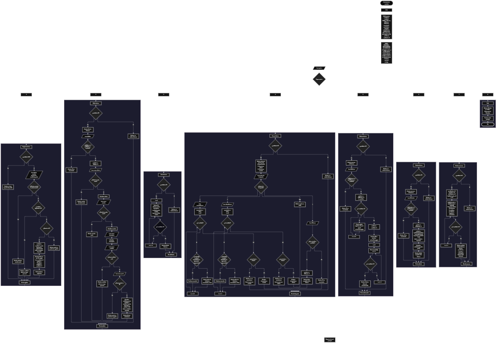

Este proyecto, llamado <b>facturador de servicios</b>, fue desarrollado en <b>visual basic .net</b> como un ejercicio práctico para fortalecer la lógica de programación mediante la creación de un sistema de gestión y cálculo de facturas desde la consola. El programa cuenta con un menú principal de ocho opciones que permite <b>registrar, editar, listar, buscar y eliminar facturas, calcular sus importes y consultar un resumen general</b>. Cada factura almacena información como el cliente, el servicio, la descripción, la cantidad, el precio, el subtotal, el impuesto y el total, utilizando diez arreglos paralelos con una capacidad máxima de <b>20 facturas durante la ejecución</b>. Durante su desarrollo se aplicaron conceptos fundamentales de programación, como variables, arreglos, estructuras condicionales, ciclos repetitivos y estructuras de selección, además de operaciones matemáticas para calcular los importes y procesos para buscar, modificar, eliminar y organizar registros. Este proyecto permite poner en práctica los conocimientos adquiridos en Visual Basic .NET y sirve como base para desarrollar sistemas de facturación más completos utilizando otros lenguajes y tecnologías.

<h2 align="center">⚙️ Funcionamiento del menú principal</h2>

### ➕ Registrar factura

La opción <b>1) registrar factura</b> permite agregar una nueva factura al sistema. Antes de realizar el registro, el programa comprueba que la cantidad de facturas almacenadas sea menor que <b>20</b>, utilizando la condición <b>cantidad &lt; ids.Length</b>. Si existe espacio disponible, solicita el <b>nombre del cliente y el nombre del servicio</b>, comprobando que ninguno esté vacío. Después, solicita la descripción, la cantidad y el precio del servicio. El programa valida que la cantidad sea mayor que cero y que el precio no sea negativo. Si los datos numéricos son válidos, calcula el subtotal multiplicando la cantidad por el precio, obtiene el impuesto aplicando el <b>19%</b> y calcula el total sumando ambos valores. Finalmente, almacena los datos en los diez arreglos, asigna un identificador consecutivo, establece el estado inicial <b>"Pendiente"</b>, incrementa la variable <b>cantidad</b> y muestra la información completa de la factura registrada. Si no existe espacio disponible o alguno de los datos obligatorios no cumple las condiciones, presenta el mensaje correspondiente e impide completar el registro.

### ✏️ Editar factura

La opción <b>2) editar factura</b> permite modificar los datos de una factura registrada. Primero, el programa comprueba si existen facturas almacenadas mediante la variable <b>cantidad</b>. Si no hay registros, muestra el mensaje <b>"No existen facturas registradas."</b>. En caso contrario, presenta una lista con la información de las facturas disponibles. Después, solicita el ID de la factura que se desea editar y comprueba que esté dentro del rango permitido mediante la condición <b>idEditar &gt;= 1 AndAlso idEditar &lt;= cantidad</b>. Si la selección es válida, obtiene su posición utilizando <b>posicion = idEditar - 1</b>. A continuación, solicita el nuevo nombre del cliente y comprueba que no esté vacío. Después, permite modificar el servicio y verifica que tampoco esté vacío. Posteriormente, solicita la nueva descripción, la cantidad y el precio. Si la cantidad es mayor que cero y el precio no es negativo, actualiza los valores correspondientes y recalcula el subtotal, el impuesto del 19% y el total. Finalmente, muestra el mensaje <b>"Factura actualizada correctamente."</b> y presenta los datos actualizados. Si el ID no corresponde a una factura registrada, muestra el mensaje <b>"ID no encontrada."</b>. Las modificaciones anteriores a una validación fallida permanecen almacenadas, ya que los datos se actualizan directamente durante el proceso.

### 📋 Listar facturas

La opción <b>3) listar facturas</b> permite visualizar todas las facturas registradas actualmente en el sistema. Antes de mostrar la información, el programa comprueba si la variable <b>cantidad</b> es igual a cero. Si no existen registros, presenta el mensaje <b>"No existen facturas registradas."</b>. Si hay facturas disponibles, utiliza un ciclo <b>For</b> para recorrer los arreglos desde la primera posición hasta la última factura registrada. Durante el recorrido, muestra el ID, el cliente, el servicio, la descripción, la cantidad, el precio, el subtotal, el impuesto, el total y el estado de cada factura. Los importes monetarios se presentan utilizando el formato <b>N2</b>, que permite mostrar dos posiciones decimales. Esta función facilita consultar todos los registros almacenados sin necesidad de buscar cada factura individualmente.

### 🔎 Buscar factura

La opción <b>4) buscar factura</b> permite localizar una factura mediante tres modalidades de búsqueda: <b>ID, cliente y servicio</b>. Primero, el programa comprueba que existan facturas registradas. Si no hay registros, muestra el mensaje <b>"No existen facturas registradas."</b>. En caso contrario, presenta un submenú para seleccionar el tipo de búsqueda. Cuando se selecciona la búsqueda por <b>ID</b>, solicita el identificador y comprueba que esté dentro del rango de facturas registradas. Si es válido, obtiene directamente la posición mediante <b>idBuscar - 1</b> y muestra todos los datos de la factura. Para la búsqueda por <b>cliente</b>, solicita el nombre y utiliza un ciclo <b>For</b> para recorrer los clientes almacenados, comparando los textos mediante <b>ToLower()</b> y <b>Contains()</b>. De manera similar, la búsqueda por <b>servicio</b> permite introducir el nombre del servicio y localizar coincidencias parciales dentro del arreglo correspondiente. En ambas búsquedas se utiliza la variable lógica <b>encontrado</b> para determinar si se localizaron registros. Si no existen coincidencias, se muestra el mensaje correspondiente. Cuando se introduce una opción que no pertenece al submenú, presenta el mensaje <b>"Opcion no valida."</b>.

### 🗑️ Eliminar factura

La opción <b>5) eliminar factura</b> permite eliminar una factura registrada mediante su identificador. Antes de comenzar, el programa comprueba que existan facturas almacenadas. Si no hay registros, muestra el mensaje <b>"No existen facturas registradas."</b>. Si existen facturas, presenta una lista resumida con el ID, el cliente, el servicio, la cantidad, el total y el estado de cada registro. Después, solicita el ID de la factura que se desea eliminar y verifica que se encuentre dentro del rango permitido. Si el identificador es válido, obtiene su posición mediante <b>idEliminar - 1</b> y comienza el proceso de eliminación. Para mantener los registros organizados, utiliza un ciclo <b>For</b> que desplaza una posición hacia atrás los datos posteriores en los diez arreglos: <b>ids, clientes, servicios, descripciones, cantidades, precios, subtotales, impuestos, totales y estados</b>. Posteriormente, disminuye la variable <b>cantidad</b> en uno, limpia la última posición ocupada y vuelve a numerar los identificadores restantes mediante otro ciclo <b>For</b>. Finalmente, muestra el mensaje <b>"Factura eliminada correctamente."</b>. Si el ID introducido no corresponde a una factura registrada, presenta el mensaje <b>"ID no encontrada."</b>.

### 🧮 Calcular factura

La opción <b>6) calcular factura</b> permite volver a calcular los importes de una factura específica y consultar su detalle completo. Primero, el programa comprueba si existen facturas registradas. Si no hay registros, muestra el mensaje <b>"No existen facturas registradas."</b>. En caso contrario, presenta una lista resumida con el ID, el cliente, el servicio, la cantidad, el precio y el total de cada factura. Después, solicita el identificador de la factura que se desea calcular y verifica que esté dentro del rango permitido. Si el ID es válido, obtiene su posición mediante <b>idCalcular - 1</b> y vuelve a calcular el subtotal multiplicando la cantidad por el precio unitario. Posteriormente, calcula el impuesto aplicando el <b>19%</b> sobre el subtotal y obtiene el total sumando ambos importes. Finalmente, muestra el detalle completo de la factura, incluyendo el cliente, el servicio, la descripción, la cantidad, el precio unitario, el subtotal, el impuesto, el total y el estado. Si el ID no corresponde a una factura registrada, presenta el mensaje <b>"ID no encontrada."</b>.

### 📊 Mostrar resumen

La opción <b>7) mostrar resumen</b> permite consultar información general sobre las facturas registradas. Primero, el programa comprueba si existen facturas almacenadas. Si no hay registros, muestra el mensaje <b>"No existen facturas registradas."</b>. En caso contrario, inicializa las variables <b>pendientes, pagadas y canceladas</b> en cero, junto con el acumulador <b>totalFacturado</b>. Después, utiliza un ciclo <b>For</b> para recorrer todas las facturas registradas y sumar sus importes al acumulador. Durante el recorrido, comprueba el estado de cada factura mediante estructuras condicionales <b>If, ElseIf</b> y cuenta los registros que se encuentran en estado <b>"Pendiente"</b>, <b>"Pagada"</b> o <b>"Cancelada"</b>. Finalmente, muestra la cantidad total de facturas, el número de facturas pendientes, pagadas y canceladas, y el importe total facturado con dos posiciones decimales. Esta función facilita consultar el estado general de los registros y conocer el valor acumulado de todas las facturas.

### 🚪 Salir del menú principal

La opción <b>8) salir</b> está destinada a finalizar la ejecución del programa y muestra el mensaje <b>"Gracias por utilizar Facturador de Servicios."</b>. El menú principal se encuentra dentro de una estructura repetitiva <b>Do ... Loop While</b>, que mantiene el programa en funcionamiento mientras la variable <b>opcion</b> sea diferente de <b>8</b>. Cuando el usuario selecciona esta opción, se ejecuta el mensaje de despedida y la condición del ciclo se vuelve falsa, finalizando la ejecución del menú principal.

<h2 align="center">🧠 Temas aplicados en el proyecto</h2>

### 📦 Variables

En este proyecto se utilizan variables para controlar la cantidad de facturas registradas, almacenar la opción seleccionada en el menú, identificar las posiciones de los registros, guardar temporalmente los datos introducidos por el usuario, realizar los cálculos matemáticos y comprobar los resultados de las búsquedas. También se utilizan variables acumuladoras y contadores para elaborar el resumen general de las facturas. Cada variable cumple una función específica dentro de las operaciones de gestión y facturación.

🔢 **Opcion:** Almacena la opción seleccionada por el usuario en el menú principal.

📊 **Cantidad:** Controla el número actual de facturas registradas.

🔄 **I:** Funciona como contador en los ciclos `For` utilizados para recorrer los arreglos y organizar los registros.

📍 **Posicion:** Almacena el índice correspondiente a la factura seleccionada mediante su identificador.

📝 **NuevoCliente:** Almacena el nombre del cliente durante el registro o la edición de una factura.

🛠️ **NuevoServicio:** Almacena el nombre del servicio durante el registro o la edición.

🔢 **NuevaCantidad:** Guarda la cantidad de unidades o servicios solicitados.

💰 **NuevoPrecio:** Almacena el precio unitario introducido por el usuario.

🧮 **NuevoSubtotal:** Guarda el resultado de multiplicar la cantidad por el precio durante el registro.

📈 **NuevoImpuesto:** Almacena el impuesto calculado sobre el subtotal.

💵 **NuevoTotal:** Guarda el importe final de la factura.

🔎 **IdBuscar:** Almacena el identificador introducido durante la búsqueda por ID.

🔍 **ClienteBuscar y ServicioBuscar:** Guardan los textos utilizados para localizar facturas por cliente o servicio.

✅ **Encontrado:** Variable lógica que indica si se encontraron coincidencias durante las búsquedas.

📊 **Pendientes, Pagadas y Canceladas:** Contabilizan las facturas según su estado.

💲 **TotalFacturado:** Acumula los importes totales de todas las facturas registradas.

### 🗃️ Arreglos

En este proyecto se utilizan diez arreglos paralelos para almacenar la información correspondiente a cada factura. Cada arreglo tiene una capacidad de <b>20 posiciones</b> y utiliza el mismo índice para representar los datos relacionados con un mismo registro. Por ejemplo, la información de una factura almacenada en la posición <b>0</b> se encuentra distribuida entre <b>ids(0), clientes(0), servicios(0), descripciones(0), cantidades(0), precios(0), subtotales(0), impuestos(0), totales(0) y estados(0)</b>. Esta organización permite administrar los datos de cada factura mediante operaciones de registro, consulta, modificación, cálculo y eliminación.

🆔 **Ids(20):** Almacena los identificadores consecutivos de las facturas.

👤 **Clientes(20):** Almacena los nombres de los clientes.

🛠️ **Servicios(20):** Almacena los nombres de los servicios facturados.

📝 **Descripciones(20):** Almacena las descripciones de los servicios.

🔢 **Cantidades(20):** Almacena las cantidades solicitadas en cada factura.

💰 **Precios(20):** Almacena los precios unitarios de los servicios.

📊 **Subtotales(20):** Almacena los importes obtenidos antes de aplicar el impuesto.

📈 **Impuestos(20):** Almacena los importes correspondientes al impuesto del 19%.

💵 **Totales(20):** Almacena los importes finales de las facturas.

📌 **Estados(20):** Almacena el estado de cada factura, establecido inicialmente como pendiente.

### 🔀 Estructuras condicionales

En este proyecto se utilizan las estructuras <b>If, ElseIf y Else</b> para comprobar diferentes condiciones durante las operaciones del sistema. Estas estructuras permiten verificar si existe espacio disponible antes de registrar una factura, comprobar que los nombres del cliente y del servicio no estén vacíos, validar que la cantidad sea mayor que cero y que el precio no sea negativo. También permiten comprobar si existen registros antes de ejecutar las operaciones, verificar los identificadores introducidos, determinar si se encontraron coincidencias durante las búsquedas y clasificar las facturas según su estado. Gracias a estas condiciones, el programa puede ejecutar instrucciones diferentes dependiendo de los datos introducidos y de la situación de cada registro.

### 🔄 Estructuras repetitivas

En este proyecto se utilizan las estructuras repetitivas <b>Do ... Loop While</b> y <b>For</b>. El ciclo <b>Do ... Loop While</b> mantiene activo el menú principal y permite que el usuario realice diferentes operaciones hasta seleccionar la opción 8. Por otro lado, los ciclos <b>For</b> permiten recorrer los arreglos para mostrar las facturas registradas, buscar coincidencias por cliente o servicio, desplazar los datos durante la eliminación y calcular el resumen general. Estas estructuras facilitan la ejecución repetida de instrucciones sin necesidad de escribir el mismo código para cada registro.

### 🎯 Estructura select case

El programa utiliza la estructura <b>Select Case</b> para evaluar el valor almacenado en la variable <b>opcion</b> y ejecutar el bloque de instrucciones correspondiente. Cada caso representa una operación específica del sistema: registrar, editar, listar, buscar, eliminar, calcular una factura, mostrar un resumen o salir del programa. También se utiliza <b>Case Else</b> para mostrar el mensaje <b>"Opcion no valida."</b> cuando el usuario introduce un número que no corresponde a ninguna de las opciones definidas en el menú principal.

### 🔢 Dimensionamiento de arreglos

En este proyecto se utiliza la declaración de arreglos con una capacidad de <b>20 posiciones</b>, mediante instrucciones como <b>Dim ids(19) As Integer</b> y sus correspondientes declaraciones para los demás arreglos. En Visual Basic .NET, declarar un arreglo con el límite superior <b>19</b> permite utilizar los índices desde <b>0 hasta 19</b>, obteniendo un total de 20 posiciones. La variable <b>cantidad</b> controla cuántas facturas se encuentran registradas y la propiedad <b>ids.Length</b> permite comprobar la capacidad máxima disponible antes de realizar un nuevo registro.

### 🧮 Operaciones matemáticas

El programa utiliza operaciones aritméticas para calcular los importes de cada factura. Primero, multiplica la cantidad por el precio unitario para obtener el subtotal. Después, calcula el impuesto aplicando una tasa del <b>19%</b> sobre el subtotal. Finalmente, suma el subtotal y el impuesto para obtener el total de la factura. Estos cálculos se realizan durante el registro, la edición y la opción de calcular factura, utilizando variables de tipo <b>Double</b> para almacenar los valores monetarios.

- **Multiplicación:** Calcula el subtotal mediante la cantidad por el precio unitario.
- **Porcentaje:** Obtiene el impuesto multiplicando el subtotal por `0.19`.
- **Suma:** Calcula el total agregando el impuesto al subtotal.
- **Acumulación:** Suma los totales de las facturas para obtener el importe total facturado.

### 🔄 Reorganización de registros

Cuando se selecciona una factura para eliminarla, el programa utiliza un ciclo <b>For</b> que comienza en la posición correspondiente al identificador seleccionado y termina en <b>cantidad - 2</b>. En cada repetición, los datos de la posición siguiente se copian sobre la posición actual en los diez arreglos. De esta manera, las facturas posteriores ocupan el espacio de la factura eliminada sin dejar posiciones vacías entre los registros activos. Después, la variable <b>cantidad</b> disminuye en uno, se limpian los datos de la última posición ocupada y se renumeran los identificadores restantes desde el número 1. Este procedimiento permite conservar la organización de los registros después de cada eliminación.

### 🔎 Búsqueda de registros

El sistema utiliza diferentes mecanismos para localizar las facturas almacenadas. La búsqueda por ID utiliza el identificador como referencia directa para obtener la posición correspondiente mediante la operación <b>idBuscar - 1</b>. Por otra parte, las búsquedas por cliente y servicio utilizan los métodos <b>ToLower()</b> y <b>Contains()</b> para comparar los textos sin distinguir entre mayúsculas y minúsculas y localizar coincidencias parciales. Durante estas operaciones se utiliza la variable lógica <b>encontrado</b> para determinar si se localizaron una o varias facturas que coincidan con el criterio solicitado.

<h2 align="center">¿Cómo se implementaron las operaciones crud en el proyecto?</h2>

Las operaciones <b>crud</b> se implementaron mediante las opciones del menú principal, permitiendo administrar las facturas registradas. La operación <b>crear</b> corresponde a <b>registrar factura</b>, donde se introducen los datos del cliente y del servicio; <b>leer</b> se realiza mediante las opciones <b>listar facturas, buscar factura y mostrar resumen</b>, que permiten consultar la información almacenada; <b>actualizar</b> corresponde a <b>editar factura</b>, donde se modifican los datos y se recalculan los importes; y <b>eliminar</b> se realiza mediante la opción <b>eliminar factura</b>, que permite retirar un registro y reorganizar los arreglos. Adicionalmente, el proyecto incorpora la opción <b>calcular factura</b>, destinada a actualizar los importes y mostrar el detalle de una factura específica. Estas operaciones utilizan variables, arreglos, condicionales, ciclos y operaciones matemáticas para gestionar la información temporalmente durante la ejecución del programa.

<h2 align="center">Diagrama de flujo del proyecto</h2>

<h2 align="center">🛡️ Validaciones del programa</h2>

### 📭 No existen facturas registradas

Esta validación se utiliza en las opciones de <b>editar, listar, buscar, eliminar, calcular factura y mostrar resumen</b>. El programa comprueba si la variable <b>cantidad</b> es igual a <b>0</b> y, si no existen facturas registradas, muestra el mensaje <b>"No existen facturas registradas."</b>. Esta comprobación evita continuar con operaciones que necesitan información almacenada cuando el sistema se encuentra vacío.

### ⚠️ Capacidad máxima alcanzada

Esta validación se utiliza durante el registro de nuevas facturas para controlar la capacidad máxima de los arreglos. El programa comprueba si <b>cantidad &lt; ids.Length</b> antes de permitir agregar un nuevo registro. Si existe espacio disponible, solicita los datos y continúa con el proceso de facturación. En caso contrario, muestra el mensaje <b>"No hay espacio para registrar mas facturas."</b>, impidiendo agregar registros cuando se han ocupado las 20 posiciones disponibles.

### 📝 Datos obligatorios vacíos

Durante el registro de una factura, el programa comprueba que el nombre del cliente y el nombre del servicio no estén vacíos. Si el cliente no introduce un nombre, muestra el mensaje <b>"El nombre del cliente no puede estar vacio."</b>. De igual manera, si el nombre del servicio está vacío, presenta el mensaje <b>"El servicio no puede estar vacio."</b>. Estas comprobaciones impiden completar el registro cuando alguno de estos dos datos obligatorios no ha sido proporcionado. La descripción, por otro lado, no cuenta con una validación que impida dejarla vacía.

### 🔢 Cantidad inválida

Esta validación se utiliza durante el registro y la edición de facturas. El programa comprueba que la cantidad introducida sea mayor que cero mediante la condición <b>nuevaCantidad &lt;= 0</b>. Si el valor es cero o negativo, muestra el mensaje <b>"La cantidad debe ser mayor que cero."</b> e impide continuar con los cálculos y el almacenamiento de los nuevos valores numéricos.

### 💰 Precio negativo

Esta validación se utiliza durante el registro y la edición de facturas para evitar que se introduzcan precios negativos. El programa comprueba si <b>nuevoPrecio &lt; 0</b>. Si la condición se cumple, muestra el mensaje <b>"El precio no puede ser negativo."</b> y no permite completar la operación con ese precio. Los valores iguales a cero sí están permitidos por la condición utilizada.

### ❌ Factura no encontrada

Esta validación se utiliza en las opciones de <b>editar, buscar, eliminar y calcular factura</b>. El programa comprueba que el ID introducido sea mayor o igual a <b>1</b> y menor o igual a la cantidad de facturas registradas. Si el identificador está fuera del rango permitido, muestra el mensaje <b>"ID no encontrada."</b>. Esta comprobación evita acceder a posiciones que no corresponden a facturas registradas.

### 🔎 Búsqueda sin coincidencias

Esta validación se utiliza durante las búsquedas por cliente y servicio. El programa inicializa la variable lógica <b>encontrado</b> con el valor <b>False</b> y recorre los arreglos correspondientes para localizar coincidencias parciales. Cuando encuentra una factura, cambia la variable a <b>True</b> y muestra sus datos. Si finaliza el recorrido sin encontrar coincidencias, presenta el mensaje <b>"No se encontraron facturas para ese cliente."</b> o <b>"No se encontraron facturas para ese servicio."</b>, dependiendo del tipo de búsqueda seleccionado.

### ⚠️ Opción inválida

La estructura <b>Select Case</b> incluye el bloque <b>Case Else</b>, que muestra el mensaje <b>"Opcion no valida."</b> cuando el usuario introduce un número que no corresponde a ninguna de las ocho opciones definidas en el menú principal. De esta manera, el programa informa que la selección introducida no pertenece a las operaciones disponibles.

<h2 align="center">🎯 Objetivo del proyecto</h2>

El objetivo principal de este proyecto es fortalecer la <b>lógica de programación</b> mediante el desarrollo de un sistema de facturación de servicios en <b>visual basic .net</b>. A través de su construcción se busca aplicar los conocimientos adquiridos sobre variables, arreglos, estructuras condicionales, ciclos repetitivos y estructuras de selección, integrándolos con operaciones matemáticas para calcular subtotales, impuestos y totales. Además, el proyecto permite comprender cómo registrar, consultar, modificar, calcular y eliminar facturas en una aplicación de consola, estableciendo una base para desarrollar sistemas de facturación y gestión comercial más completos con otros lenguajes y tecnologías.

